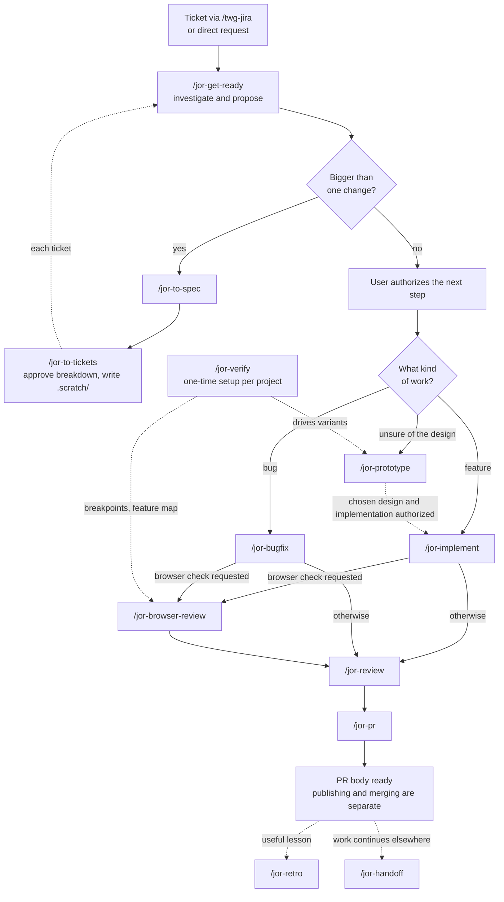

# jor-stack

jor-stack is Jorge Galarza's private collection of front-end workflow skills for Cursor and Codex.

## Skills and triggers

**1 automatic, 20 manual.**

| Trigger | Skills |
| --- | --- |
| Automatic — agent guidance | `jor-writing-for-agents` |
| Manual — planning | `jor-mode`, `jor-get-ready`, `jor-restate`, `jor-grill-me`, `jor-to-spec`, `jor-to-tickets` |
| Manual — implementation | `jor-implement`, `jor-tdd`, `jor-bugfix`, `jor-design`, `jor-domain`, `jor-prototype` |
| Manual — verification | `jor-browser-review`, `jor-review`, `jor-verify`, `jor-verify-maintain` |
| Manual — delivery and explanation | `jor-pr`, `jor-retro`, `jor-handoff`, `jor-teach` |

Commands below use Cursor's `/jor-...` syntax. In Codex, use `$jor-...`, or `$jor-stack:jor-...` when the picker shows the plugin namespace. For example: `/jor-bugfix`, `$jor-bugfix`, or `$jor-stack:jor-bugfix`.

`jor-writing-for-agents` can also be selected automatically for agent guidance work. The other 20 skills set `disable-model-invocation: true` for Cursor and `policy.allow_implicit_invocation: false` in `agents/openai.yaml` for Codex. A skill can read a supporting skill's instructions within the current task; the user invokes the next workflow step.

Skill sources and exact upstream commits are in [UPSTREAM.md](UPSTREAM.md).

The manifests remain at version 0.1.1. The working tree also contains the updates under **Unreleased** in [CHANGELOG.md](CHANGELOG.md); installing from GitHub or `git archive HEAD` includes only committed files. Plugin installs bundle Chrome DevTools MCP; standalone skill links do not.

## How work flows



Solid arrows are the main path. Dashed arrows are loops and supporting links.
The same diagram source is kept in [docs/flow.mmd](docs/flow.mmd).

1. **Load the task.** Bring a Jira ticket into the conversation with `/twg-jira`, or state the request directly. The request, acceptance criteria, and relevant discussion set the scope. Jira access is only needed for Jira work.
2. **`/jor-get-ready` investigates and proposes.** It reads the task and project rules, inspects the code, callers, tests and patterns, and reproduces the bug or confirms the gap. When a decision is unclear it reads the grill-me skill and follows it. It returns a proposal with evidence, the smallest complete change, risks and checks, then stops. It changes no files.
3. **Bigger than one change?** If yes, `/jor-to-spec` confirms unresolved test seams and writes `.scratch/<feature-slug>/spec.md`. `/jor-to-tickets` proposes a breakdown and writes one file per ticket only after approval, under `.scratch/<feature-slug>/issues/`. Run `/jor-get-ready` for each ticket whose blockers are complete. These files do not create or change Jira issues.
4. **Authorize the next step.** `/jor-get-ready` stops at its proposal. Once implementation is authorized, use `/jor-implement` for a feature or `/jor-bugfix` for a bug. Use `/jor-prototype` to answer a design question; a chosen design needs implementation authorization before production edits.
5. **Verify and review.** Run the smallest relevant checks. Use `/jor-browser-review` when browser verification is requested, then `/jor-review` with a fixed point such as a branch, tag, or commit. Fix accepted findings in an authorized implementation pass and repeat the affected checks and review.
6. **Prepare delivery.** `/jor-pr` writes the PR body from the current change and actual evidence. It does not commit, push, open, or merge a PR. Request those actions separately. Use `/jor-retro` for a useful lesson and `/jor-handoff` when work continues elsewhere; neither is a required step for every change.

## Verification workflow

### Prevention pyramid

When correcting an agent, prefer the first practical layer below. Spend most effort preventing mistakes through code and automated checks; reserve human review for remaining decisions.

| Pyramid layer | Stack coverage | What establishes it works |
| --- | --- | --- |
| **Codebase** | `jor-domain`, `jor-design`, and `jor-retro` favor stronger types, invariants, and clear boundaries. | An applied code change removes the failure path. |
| **Automated checks** | `jor-implement` requires new guards to catch the fault, pass after the fix, and join normal checks or CI. | Actual failure/pass results and evidence that the guard runs routinely. |
| **Prose** | Skills guide implementation, verification, and review. `jor-retro` reserves guidance for judgment. | Short, consistent instructions with clear completion criteria. |
| **Human review** | Browser review supplies exact URLs; retro identifies remaining product choices and risks. | People focus on decisions the automated checks cannot settle. |

The skills themselves are prose. Their outputs strengthen the top two layers when structural changes and executable guards are implemented. `/jor-verify` adds scripts for existing repo checks alongside browser instructions. CI coverage requires shared files and explicit integration; browser journeys stay on Chrome DevTools MCP.

### Set up once per project

For projects that need browser verification, run `/jor-verify` to create `.agents/skills/verify-<project>/`. If the project already uses `.cursor/skills/`, it asks which location to use. Choose whether the generated skill is private or shared. It remains manual-only in Cursor and Codex, uses Chrome DevTools MCP, and contains:

- `doctor`: check the app is healthy before driving it.
- `breakpoints`: capture the target UI state at 360, 768, 1280, 1440, and 1920 px wide.
- `snapshot`: capture page state, screenshots, console messages, and network results.
- A feature map: routes, real user actions, and observable results that prove each journey works.
- `checks`, when useful repo commands exist: a Node.js runner and a project-specific plan for nonbrowser checks. It prints short results, saves full logs, and exits nonzero on failed or blocked checks. The runner supports macOS and Linux.

Setup runs the scripted checks when generated, proves one mapped journey end to end, and confirms logs and browser evidence survive cleanup. An unexecuted verification skill remains a draft. Evidence goes under `.scratch/verify/`. Missing commands, prerequisites, and absent scripted coverage are reported explicitly.

For the plan format, example invocation, exit codes, and CI limits, see [scripted checks](skills/jor-verify/references/scripted-checks.md). The runner executes every configured check without streaming full logs into the chat. It does not select commands or configure required CI checks; generated plans must leave product source and fixtures unchanged and respect the server and browser boundaries.

`/jor-prototype`, `/jor-browser-review`, and `/jor-bugfix` read the generated skill from `.agents/skills/` first, then `.cursor/skills/`. If neither exists, they recommend `/jor-verify`.

### For each change

Invoke the main steps manually. Browser checks require an explicit request in the current chat; invoking a browser workflow authorizes its stated checks. Development servers stay under your control: starting, stopping, or restarting one requires an explicit request. A missing browser tool, server, or prerequisite is reported as a limit, never as a passing check.

| Step | Skill | Verification |
| --- | --- | --- |
| Build or fix | `/jor-implement` or `/jor-bugfix` | Implementation runs the smallest relevant repo checks and broadens coverage when risk, failures, or project rules require it. Bug fixing reproduces the exact symptom, checks the fix, and reruns the original scenario. |
| Check UI when requested | `/jor-browser-review` | Prefer an independent reviewer. Use the project's health check, feature map, and breakpoints to check real interactions, layout, overflow, console errors, and failed requests. Return evidence and exact URLs for human verification. |
| Review code | `/jor-review` | Supply a fixed point. Review committed changes plus staged, unstaged, and in-scope untracked files. Report Standards and Spec findings separately; Spec uses the ticket, spec, or current request. This read-only review does not execute or fix the feature. |
| Prepare delivery | `/jor-pr` | Write the PR body with the smallest useful visual, before/after evidence, rollback risk, and blast radius. |

Implementation closeout reports what was checked, exact commands, observed results, evidence paths where applicable, and blocked or unverified scope. Re-run affected checks after later edits.

A new or repaired automated guard must catch the original fault before passing with the fix, and run through the repo's normal check command, hook, or CI configuration. Distinguish local execution from CI that has only been configured. UI and CI are verified only when their checks actually run.

### Improve future runs

- **`/jor-retro`** after a useful lesson: you corrected the agent, review found something checks missed, a mistake repeated, or the agent wasted time finding code or using tools. It proposes prevention using the [pyramid](#prevention-pyramid) and makes no edits. Accepted code or check changes go to `/jor-implement`; accepted guidance changes go to `/jor-writing-for-agents`. Skip it when there is no useful lesson.
- **`/jor-verify-maintain`** on demand or after UI-heavy sprints. It runs the generated scripted checks when present, reviews source and drives every mapped feature live, updates stale verification instructions, and reports product bugs separately. Outcomes are clean, changed, or blocked.

## Outside the main flow

- **`/jor-writing-for-agents`** creates, edits, reviews, or consolidates skills and agent instructions such as `AGENTS.md` and `CLAUDE.md`. It applies automatically to these requests and includes its own skill mechanics reference. This replaces the standalone `writing-for-agents` skill.
- **`/jor-tdd`** guides test-first development: one failing test, then the smallest implementation that passes, at agreed seams. `jor-implement` reads it when the work calls for test-first development.
- **`/jor-grill-me`** when you start from an idea instead of a ticket. It interviews you until every decision is settled.
- **`/jor-restate`** when you want to check the agent understood your goal before it starts.
- **`/jor-design`** and **`/jor-domain`** while shaping code. `/jor-design` gives the vocabulary for module interfaces and seams. `/jor-domain` pushes logic into the right data structure instead of more `if` branches.
- **`/jor-mode`** when you don't remember which skill fits.
- **`/jor-teach`** when you want to really understand a change or subsystem.

## Private working files

Specs, local tickets, verification evidence, prototype screenshots, bug captures, and run notes go in `.scratch/` inside the project. Before writing there, ensure `.scratch/` is in Git's local exclude file (resolve it with `git rev-parse --git-path info/exclude`, including in worktrees). Never edit the team's shared `.gitignore` or commit these files.

Generated verify skills live in the selected `.agents/skills/` or `.cursor/skills/` folder. Exclude that folder locally when private; shared skills can be included in an authorized commit. `/jor-handoff` writes to the OS temporary directory. Prototype source follows the project's structure and requires commit authorization.

## Rules every skill follows

- **One skill per job.** A started skill can read supporting instructions, such as `jor-get-ready` reading `jor-grill-me`. It recommends the next manual skill for the user to invoke. Automatic selection of `jor-writing-for-agents` stays within the requested guidance work.
- **Self-contained.** No skills outside jor-stack except the `/twg-jira` entry point.
- **Tool-neutral.** Shared instructions and resources work in Cursor and Codex, with no hardcoded model names.
- **Upstream voice kept.** Skills marked close to upstream keep the original wording. Trims cut text rather than rewrite it.
- **Traceable.** Each skill's frontmatter has a `metadata.based-on` line naming the upstream repo, path and commit, or "original by Jorge".

## How your edits stay safe from upstream

- **Copies, not links.** Every skill is a copy inside this repo. Nothing pulls from Matt's repo or pstack at runtime, so an upstream change can't overwrite your edits.
- **Recorded commits.** [UPSTREAM.md](UPSTREAM.md) lists the exact commit each skill was copied from, so you can diff upstream against that point later.
- **Edit only in this repo.** Never edit the installed copy in Cursor's plugin cache. It's replaced on every update. Change the repo, commit, and reinstall or refresh.
- **Upstream updates are a manual review.** When an upstream skill changes, compare it with the recorded commit and merge by hand only what you want.

## Install

Use one installation method per app to avoid duplicate entries. Jira tasks need `/twg-jira` from twg. Browser workflows need Node.js, Chrome, and Chrome DevTools MCP. Other skills do not need Jira or a browser.

### Cursor

Choose one:

- **Local folder.** Commit the plugin changes, then export `git archive HEAD` into a fresh `~/.cursor/plugins/local/jor-stack` folder and run **Developer: Reload Window**. Replace an existing install rather than overlaying it, so old private rules are removed. Export committed files instead of copying the working checkout, which can contain private local rules and `AGENTS.md`. A real folder is safest: Cursor skips symlinks that point outside `~/.cursor/plugins/local`.
- **From GitHub.** In Cursor open **Customize → From GitHub Repository** and paste `https://github.com/jorsisu/jor-stack`. The repo root has `.cursor-plugin/marketplace.json`, which lists the single `jor-stack` plugin at the root.

Open **Customize** afterwards and confirm the 21 `jor-` skills, including `jor-bugfix`, and the `chrome-devtools` MCP server are listed. See [Cursor's plugin guide](https://cursor.com/docs/plugins). The MCP server runs `npx -y chrome-devtools-mcp@latest`.

### Codex

Choose one:

- **Plugin.** This repo includes a portable `plugin.json` and a repo marketplace at `.agents/plugins/marketplace.json`, pointing to the repo root. Add the marketplace with `codex plugin marketplace add .` from this directory, then restart the desktop app and install `jor-stack` from that marketplace. The plugin loads the same `skills/` and `mcp.json` as Cursor. See the [OpenAI plugin packaging guide](https://developers.openai.com/plugins/build/plugins).
- **Shared skill links.** Use the commands below for standalone skills. Keep this checkout at the same path.

From this repository's root, link each skill into the shared user skill directory:

```sh
mkdir -p "$HOME/.agents/skills"
for skill in "$PWD"/skills/jor-*; do
  skill_target="$HOME/.agents/skills/$(basename "$skill")"
  if [ ! -e "$skill_target" ] && [ ! -L "$skill_target" ]; then
    ln -s "$skill" "$skill_target"
  fi
done
```

Existing files, folders, and links are preserved. After a skill rename, replace only the old link that points to this checkout; the loop does not remove stale links. Links use this checkout as the source, so keep it at the same path and edit skills here. Use the skill picker to select `jor-mode`; it can appear as `$jor-stack:jor-mode` when Codex adds the plugin namespace. If the skills do not appear on the next turn, restart Codex.

These are standalone skills. Cursor also discovers the shared directory; use one installation method per app to avoid duplicate entries. Codex does not load this repository's `mcp.json` through skill links: browser skills require a separately configured Chrome DevTools MCP server.

## After install

1. Remove the pstack plugin.
2. Remove Matt Pocock's skills.
3. Archive the old `get-ready`, `restate`, `browser-review`, `implement` and `writing-for-agents` skills outside skill discovery, so only the `jor-` versions remain.
4. For browser work, complete the [verification setup](#set-up-once-per-project) in the target project.

## Not in v0.1 / roadmap

### Already decided out

- pstack `figure-it-out` (was `/jor-plan`). Covered by `/jor-to-spec` + `/jor-to-tickets`.
- pstack `principle-prove-it-works` as a separate skill. Proof requirements live in `/jor-implement` and the [verification workflow](#verification-workflow).
- pstack `in-your-own-words`. Covered by `/jor-restate`.
- pstack `interrogate`, `arena`, `architect`. Multi-model checks, too heavy.
- pstack `swarm`. Parallel agents.
- pstack formal verification skills and `statechart`.
- pstack `benchmark-checklist`, `recall`, `technical-writing`.
- Matt's `grilling`. Inlined in `/jor-grill-me`.
- Matt's `grill-with-docs`. It writes docs.
- Matt's `setup-matt-pocock-skills`. Not needed.
- Matt's other skills, including the auto-triggering ones.
- Addy Osmani's agent-skills.

### Skipped by default, could be added later

- pstack `blast-radius`, `how`, `why`, `unslop`, `reflect`, `sharpen`, `ketchup`, `correct`, `show-me-your-work`, `bro`, `no-comments`, `automate-me`, `setup-pstack`.
- pstack's other `principle-*` skills.

### Planned later

- **Skill doctor.** A bot that watches upstream and proposes merges without overwriting your edits.
- **Emil Kowalski's animation skills** ([emilkowalski/skills](https://github.com/emilkowalski/skills)) as `jor-` skills. They're installed separately for now.

## License

[MIT](LICENSE). Copyright (c) 2026 Jorge Galarza. Third-party skill text is MIT as well; the full notices are in [THIRD_PARTY_NOTICES.md](THIRD_PARTY_NOTICES.md).
