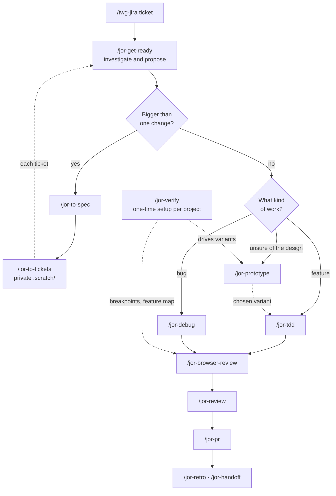

# jor-stack

jor-stack is Jorge Galarza's private collection of front-end workflow skills for Cursor and Codex.

## Skills and triggers

**0 automatic, all 19 manual.**

| Trigger | Skills |
| --- | --- |
| Automatic | None |
| Manual — planning | `jor-mode`, `jor-get-ready`, `jor-restate`, `jor-grill-me`, `jor-to-spec`, `jor-to-tickets` |
| Manual — implementation | `jor-tdd`, `jor-debug`, `jor-design`, `jor-domain`, `jor-prototype` |
| Manual — verification | `jor-browser-review`, `jor-review`, `jor-verify`, `jor-verify-maintain` |
| Manual — delivery and explanation | `jor-pr`, `jor-retro`, `jor-handoff`, `jor-teach` |

Invoke with `$jor-debug` in Codex or `/jor-debug` in Cursor. Every skill sets `disable-model-invocation: true` for Cursor and `policy.allow_implicit_invocation: false` in `agents/openai.yaml` for Codex.

Skill sources and exact upstream commits are in [UPSTREAM.md](UPSTREAM.md).

Version 0.1.1 ships for Cursor. See [CHANGELOG.md](CHANGELOG.md). It bundles Chrome DevTools MCP for the browser skills.

## How a ticket flows



<details>
<summary>SVG copy of the chart (<code>docs/flow.svg</code>)</summary>



</details>

Solid arrows are the main path. Dashed arrows are loops and supporting links.

1. **Load the ticket.** Bring the Jira ticket into the conversation with `/twg-jira`. Its description, acceptance criteria and comments set the scope.
2. **`/jor-get-ready` investigates and proposes.** It reads the ticket and project rules, inspects the code, callers, tests and patterns, and reproduces the bug or confirms the gap. When a decision is unclear it reads the grill-me skill and follows it. It returns a proposal with evidence, the smallest complete change, risks and checks, then stops. It changes no files.
3. **Bigger than one change?** If yes, `/jor-to-spec` writes the spec to `.scratch/<feature-slug>/spec.md`. Then `/jor-to-tickets` splits it into tracer-bullet tickets, one file each under `.scratch/<feature-slug>/issues/`, blockers first. Run `/jor-get-ready` for each ticket.
4. **What kind of work?** For a feature, `/jor-tdd` builds it one red-green slice at a time at seams you agree on. For a bug, `/jor-debug` builds a tight feedback loop first, then reproduces, minimises, hypothesises, instruments, and fixes with a regression test. If you're unsure of the design, `/jor-prototype` builds throwaway variants, screenshots them at the project's breakpoints for side-by-side comparison, and the chosen variant goes into `/jor-tdd`.
5. **`/jor-browser-review` checks it in a real browser.** It uses Chrome DevTools MCP, preferably through one independent subagent. It checks the breakpoints 360, 768, 1280, 1440 and 1920, interactions, overflow, console errors and failed requests. It ends with a Human verification section of exact URLs for you to open.
6. **`/jor-review` reviews the diff on two axes.** Standards covers the repo's coding standards plus a code-smell baseline. Spec checks against the ticket already in the conversation or the `/jor-to-spec` file. The two reports stay separate.
7. **`/jor-pr` writes the PR body.** It shows the smallest visual that explains the change, before and after evidence (screenshots are best), and the merge danger: one-way or two-way door, and blast radius.
8. **`/jor-retro` and `/jor-handoff` close the loop.** `/jor-retro` suggests improvements to the agent's environment (checks, standards, navigation pointers), not the code. `/jor-handoff` writes a handoff file when the work continues in a fresh session, another directory, or with a colleague.

**One-time setup per project: `/jor-verify`.** It writes the project's own skill to `.agents/skills/verify-<project>/` (if the project already uses `.cursor/skills/`, it asks which). The skill runs on Chrome DevTools MCP, with `doctor` (health check), `breakpoints` (screenshots at 360, 768, 1280, 1440 and 1920) and `snapshot` (page and DOM state) commands, plus a feature map. `/jor-prototype`, `/jor-browser-review`, and `/jor-debug` read `.agents/skills/verify-<project>/SKILL.md` first, then `.cursor/skills/verify-<project>/SKILL.md`. Breakpoint screenshots from a verify run are saved under `.scratch/verify/`. If neither skill file exists, those skills recommend you run `/jor-verify`.

## Outside the main flow

- **`/jor-grill-me`** when you start from an idea instead of a ticket. It interviews you until every decision is settled.
- **`/jor-restate`** when you want to check the agent understood your goal before it starts.
- **`/jor-design`** and **`/jor-domain`** while shaping code. `/jor-design` gives the vocabulary for module interfaces and seams. `/jor-domain` pushes logic into the right data structure instead of more `if` branches.
- **`/jor-mode`** when you don't remember which skill fits.
- **`/jor-teach`** when you want to really understand a change or subsystem.
- **`/jor-verify-maintain`** on demand or after UI-heavy sprints. It reports clean, changed, or blocked.

## Private working files

Specs, tickets, verification evidence and run notes go in `.scratch/` inside the project. Before writing there, the skills check `.git/info/exclude` and add `.scratch/` if it's missing. That file is git's local-only ignore list, so the files stay private to your machine. The team's shared `.gitignore` is never touched, and these files are never committed.

## Rules every skill follows

- **One skill per job.** A started skill can read supporting instructions, such as `jor-get-ready` reading `jor-grill-me`. It recommends the next skill for the user to invoke.
- **Self-contained.** No skills outside jor-stack except the `/twg-jira` entry point.
- **Tool-neutral.** Shared instructions and resources work in Cursor and Codex, with no hardcoded model names.
- **Upstream voice kept.** Skills marked close to upstream keep the original wording. Trims cut text rather than rewrite it.
- **Traceable.** Each skill's frontmatter has a `metadata.based-on` line naming the upstream repo, path and commit, or "original by Jorge".

## How your edits stay safe from upstream

- **Copies, not links.** Every skill is a copy inside this repo. Nothing pulls from Matt's repo or pstack at runtime, so an upstream change can't overwrite your edits.
- **Recorded commits.** [UPSTREAM.md](UPSTREAM.md) lists the exact commit each skill was copied from, so you can diff upstream against that point later.
- **Edit only in this repo.** Never edit the installed copy in Cursor's plugin cache. It's replaced on every update. Change the repo, commit, and reinstall or refresh.
- **Upstream updates are a manual review.** When an upstream skill changes, compare it with the recorded commit and merge by hand only what you want.

## Install

Prerequisites: `/twg-jira` from twg, Node.js for chrome-devtools-mcp, and Chrome.

### Cursor

Choose one:

- **Local folder.** Commit the plugin changes, then export `git archive HEAD` into a fresh `~/.cursor/plugins/local/jor-stack` folder and run **Developer: Reload Window**. Replace an existing install rather than overlaying it, so old private rules are removed. Export committed files instead of copying the working checkout, which can contain private local rules and `AGENTS.md`. A real folder is safest: Cursor skips symlinks that point outside `~/.cursor/plugins/local`.
- **From GitHub.** In Cursor open **Customize → From GitHub Repository** and paste `https://github.com/jorsisu/jor-stack`. The repo root has `.cursor-plugin/marketplace.json`, which lists the single `jor-stack` plugin at the root.

Open **Customize** afterwards and confirm the 19 `jor-` skills and the `chrome-devtools` MCP server are listed. The MCP server runs `npx -y chrome-devtools-mcp@latest`, so Node.js and Chrome must be installed.

### Codex

From this repository's root, link each skill into the shared user skill directory:

```sh
mkdir -p "$HOME/.agents/skills"
for skill in "$PWD"/skills/jor-*; do
  ln -s "$skill" "$HOME/.agents/skills/$(basename "$skill")"
done
```

Existing destinations are preserved. Links use this checkout as the source, so keep it at the same path and edit skills here. Use the skill picker to select `jor-mode`; it can appear as `$jor-stack:jor-mode` when Codex adds the plugin namespace. If the skills do not appear on the next turn, restart Codex.

These are standalone skills. Cursor also discovers the shared directory; use one installation method per app to avoid duplicate entries. Codex does not load this repository's `mcp.json` through skill links: browser skills require a separately configured Chrome DevTools MCP server.

## After install

1. Remove the pstack plugin.
2. Remove Matt Pocock's skills.
3. Remove the old `get-ready`, `restate` and `browser-review` skills, so only the `jor-` versions remain.
4. Run `/jor-verify` once in each project. It writes `.agents/skills/verify-<project>/`, or `.cursor/skills/verify-<project>/` if you already keep skills there and choose that.

## Not in v0.1 / roadmap

### Already decided out

- pstack `figure-it-out` (was `/jor-plan`). Covered by `/jor-to-spec` + `/jor-to-tickets`.
- pstack `principle-prove-it-works`. Covered by `/jor-browser-review`.
- pstack `in-your-own-words`. Covered by `/jor-restate`.
- pstack `interrogate`, `arena`, `architect`. Multi-model checks, too heavy.
- pstack `swarm`. Parallel agents.
- pstack formal verification skills and `statechart`.
- pstack `benchmark-checklist`, `recall`, `technical-writing`.
- Matt's `grilling`. Inlined in `/jor-grill-me`.
- Matt's `grill-with-docs`. It writes docs.
- Matt's `setup-matt-pocock-skills`. Not needed.
- Matt's other skills, including the auto-triggering ones.
- Addy Osmani's agent-skills.

### Skipped by default, could be added later

- pstack `blast-radius`, `how`, `why`, `unslop`, `reflect`, `sharpen`, `ketchup`, `correct`, `show-me-your-work`, `bro`, `no-comments`, `automate-me`, `setup-pstack`.
- pstack's other `principle-*` skills.

### Planned later

- **Skill doctor.** A bot that watches upstream and proposes merges without overwriting your edits.
- **Emil Kowalski's animation skills** ([emilkowalski/skills](https://github.com/emilkowalski/skills)) as `jor-` skills. They're installed separately for now.

## License

[MIT](LICENSE). Copyright (c) 2026 Jorge Galarza. Third-party skill text is MIT as well; the full notices are in [THIRD_PARTY_NOTICES.md](THIRD_PARTY_NOTICES.md).
