# jor-stack

jor-stack is Jorge Galarza's private collection of front-end workflow skills for Cursor and Codex.

## Skills and triggers

**3 automatic, 20 manual.**

| Trigger | Skills |
| --- | --- |
| Automatic — agent guidance | `jor-writing-for-agents` |
| Automatic — after implementation checks | `jor-peer-review` |
| Automatic — stack audit requests | `jor-dr-stack` |
| Manual — planning | `jor-mode`, `jor-get-ready`, `jor-restate`, `jor-grill-me`, `jor-to-spec`, `jor-to-tickets` |
| Manual — implementation | `jor-implement`, `jor-tdd`, `jor-bugfix`, `jor-design`, `jor-domain`, `jor-prototype` |
| Manual — verification | `jor-browser-review`, `jor-review`, `jor-verify`, `jor-verify-maintain` |
| Manual — delivery and explanation | `jor-pr`, `jor-retro`, `jor-handoff`, `jor-teach` |

Commands below use Cursor's `/jor-...` syntax. In Codex, use `$jor-...`, or `$jor-stack:jor-...` when the picker shows the plugin namespace. For example: `/jor-bugfix`, `$jor-bugfix`, or `$jor-stack:jor-bugfix`.

`jor-writing-for-agents` can be selected automatically for agent guidance work. `jor-peer-review` runs automatically after `jor-implement` or `jor-bugfix` checks pass, and can also be requested explicitly. `jor-dr-stack` can be selected for stack consistency audit requests. These three allow implicit invocation in Cursor and Codex. The other 20 skills set `disable-model-invocation: true` for Cursor and `policy.allow_implicit_invocation: false` in `agents/openai.yaml` for Codex. A skill can read supporting instructions within the current task; implementation and bugfix follow the linked peer-review instructions before closeout. The user invokes other workflow steps.

Skill sources and exact upstream commits are in [UPSTREAM.md](UPSTREAM.md).

The manifests remain at version 0.1.1. The working tree also contains the updates under **Unreleased** in [CHANGELOG.md](CHANGELOG.md); installing from GitHub or `git archive HEAD` includes only committed files. Plugin installs bundle Chrome DevTools MCP; standalone skill links do not.

## How work flows

Read the numbered stages from top to bottom. Diamonds show decisions; retry boxes name the stage to repeat. Peer review runs automatically as part of implementation or bug fixing. Invoke other workflow steps separately.

The final verification step is optional `/jor-review` for large changes, after any requested browser review and fixes, before PR preparation.

```mermaid
flowchart TB
    task(["Initial request or ticket"]):::step

    subgraph intake["1. Understand the request"]
        direction TB
        context{"Enough context?"}:::decision
        ready("jor-get-ready<br/>Investigate and clarify"):::step
        pause("Report findings or proposal<br/>Wait for user request"):::stop
        context -->|No| ready
        ready --> pause
    end

    subgraph work["2. Choose and authorize the work"]
        direction TB
        route{"What is needed?"}:::decision
        bugfix("jor-bugfix<br/>Reproduce and diagnose<br/>Fix only within authorized scope"):::step
        wider("Report wider scope<br/>Wait for scope approval"):::stop
        spec("jor-to-spec<br/>Capture agreed requirements"):::step
        tickets("jor-to-tickets<br/>Approve breakdown and write tasks"):::step
        next("jor-get-ready<br/>Assess next unblocked ticket"):::step
        ticketpause("Report findings or proposal<br/>Wait for user request, then repeat stage 2"):::stop
        bugpause("Report investigation findings<br/>Wait for user request, then repeat stage 2"):::stop
        approved{"Implementation authorized<br/>for this scope?"}:::decision
        noauth("Report findings or proposal<br/>Wait for implementation request"):::stop
        implement("jor-implement<br/>Build a feature or known fix"):::step

        route -->|Unknown bug cause| bugfix
        route -->|Several deliverables| spec
        route -->|One clear change| approved
        bugfix -->|Investigation only| bugpause
        bugfix -->|Wider fix needed| wider
        wider -->|Scope approved; user invokes| spec
        spec --> tickets
        tickets --> next
        next --> ticketpause
        approved -->|No| noauth
        approved -->|Yes| implement
    end

    subgraph verification["3. Check and peer review"]
        direction TB
        checks("Run relevant checks"):::step
        result{"Check result?"}:::decision
        blocked("Report limit<br/>Stop verification"):::stop
        checkfix("Fix within authorized scope<br/>Repeat implementation and checks in stages 2–3"):::step
        peer("jor-peer-review<br/>Automatic: review, fix, recheck<br/>At most one focused recheck"):::step
        peerissues{"Unresolved findings?"}:::decision
        remaining("Report remaining findings<br/>Wait for next step"):::stop

        checks --> result
        result -->|Blocked or outside scope| blocked
        result -->|In-scope code failure| checkfix
        result -->|Pass| peer
        peer --> peerissues
        peerissues -->|Yes| remaining
    end

    subgraph browserStage["4. Optional browser review"]
        direction TB
        requested{"Browser check requested?"}:::decision
        browser("jor-browser-review"):::optional
        browserfixes{"Code changes needed?"}:::decision
        browserretry("Authorized implementation, checks and peer review<br/>Then repeat browser review in stage 4"):::step

        requested -->|Yes| browser
        browser --> browserfixes
        browserfixes -->|Yes| browserretry
    end

    subgraph fullStage["5. Optional final full review"]
        direction TB
        full{"Full review requested<br/>for a large change?"}:::decision
        review("jor-review<br/>Review against a fixed base"):::optional
        codefixes{"Code changes needed?"}:::decision
        reviewretry("Authorized implementation, checks and peer review<br/>Repeat any requested browser review<br/>Full review remains user-invoked"):::step

        full -->|Yes| review
        review --> codefixes
        codefixes -->|Yes| reviewretry
    end

    subgraph deliveryStage["6. Prepare delivery"]
        direction TB
        pr("jor-pr<br/>Prepare PR body"):::step
        publish("Separate authorization:<br/>commit, push, open or merge PR"):::step
        pr --> publish
    end

    done(["End of workflow"]):::step

    task --> context
    context -->|Yes| route
    pause -->|User requests next step| route
    bugfix -->|Scoped fix complete| checks
    implement --> checks
    peerissues -->|No| requested
    requested -->|No| full
    browserfixes -->|No| full
    full -->|No| pr
    codefixes -->|No| pr
    publish --> done

    %% Invisible links keep each complete stage above the next stage.
    ticketpause ~~~ checks
    bugpause ~~~ checks
    noauth ~~~ checks
    blocked ~~~ requested
    checkfix ~~~ requested
    remaining ~~~ requested
    browserretry ~~~ full
    reviewretry ~~~ pr

    classDef step fill:#002337,stroke:#334650,color:#58b9ef,stroke-width:1px,rx:16,ry:16
    classDef decision fill:#002337,stroke:#58b9ef,color:#58b9ef,stroke-width:1.5px
    classDef optional fill:#002337,stroke:#58b9ef,color:#58b9ef,stroke-width:1.5px,stroke-dasharray:4 4,rx:16,ry:16
    classDef stop fill:#002337,stroke:#888888,color:#c7ced3,stroke-width:1px,rx:16,ry:16
    linkStyle default stroke:#888888,stroke-width:1.5px
```



The same diagram source is kept in [docs/flow.mmd](docs/flow.mmd).

1. **Load the task.** Bring a Jira ticket into the conversation with `/twg-jira`, or state the request directly. The request, acceptance criteria, and relevant discussion set the scope. Jira access is only needed for Jira work.
2. **Check context.** If the request and relevant code are already understood, skip `/jor-get-ready` and choose the route below. Otherwise, it investigates the code, callers, tests, and current behavior. It reads the grill-me skill when product decisions remain unclear, then returns a proposal with evidence, risks, and checks. It changes no files.
3. **Choose by uncertainty and scope.** Use `/jor-bugfix` when a bug's cause is unknown. Diagnose it before planning a larger fix. Use `/jor-implement` for one clear change, including a bug fix whose cause and intended change are established. When understood work needs several deliverables, use `/jor-to-spec` to capture agreed requirements and test seams in `.scratch/<feature-slug>/spec.md`. Then `/jor-to-tickets` proposes a breakdown and writes one file per ticket after approval under `.scratch/<feature-slug>/issues/`. Run `/jor-get-ready` for each ticket whose blockers are complete and choose its next step from the findings. These files do not create or change Jira issues.
4. **Keep changes within the authorized scope.** A direct implementation request supplies authorization for its stated scope; an investigation-only request ends at the findings or proposal until you authorize implementation. If diagnosis reveals several deliverables or a wider fix, propose the spec-and-ticket path before expanding the work. Use `/jor-prototype` when a design question needs exploration, then authorize production edits for the chosen design.
5. **Automatic peer review, then optional browser and full review.** After checks pass, `/jor-implement` and `/jor-bugfix` follow [jor-peer-review](skills/jor-peer-review/SKILL.md) without another request. One independent, read-only agent reviews the task's changes and directly affected code for concrete bugs, regressions, and missed requirements; if subagents are unavailable, the current agent performs the same review and labels it self-review. The main agent assesses findings, fixes valid issues within scope, reruns affected checks, and requests one focused recheck if fixes were made. Report remaining findings after that limit. No base commit or full standards audit is required. Run `/jor-browser-review` when requested. If browser findings need code changes, use an authorized implementation pass with its checks and peer review, then repeat the requested browser check. For large changes, optionally request full `/jor-review` after browser findings and fixes are settled; if browser review was skipped, full review can follow peer review directly.
6. **Prepare delivery.** `/jor-pr` writes the PR body from the current change and actual evidence. It does not commit, push, open, or merge a PR. Request those actions separately. Use `/jor-retro` for a useful lesson and `/jor-handoff` when work continues elsewhere; neither is a required step for every change.

## Verification workflow

Verification combines executable checks, code review, and requested browser checks. Each proves different behavior: passing unit tests does not establish that the UI works or CI passed. Automatic peer review is an instruction followed by the implementation agent; it is not a Git hook or required CI status.

Choose the verification skill by the job:

| Your need | Use | Coverage |
| --- | --- | --- |
| This project has no reusable verification guide | `/jor-verify` | Create a project skill and prove one mapped feature journey. |
| Check the UI for the current change | `/jor-browser-review` | Exercise the affected features using the project skill. |
| The existing guide may be stale | `/jor-verify-maintain` | Check the guide against source and exercise every mapped feature. |

These commands run when requested; they do not schedule future checks. In Codex, use `$jor-...` or the plugin-qualified `$jor-stack:jor-...` form.

### Prevention pyramid

When correcting an agent, prefer the first practical layer below. Spend most effort preventing mistakes through code and automated checks; reserve human review for remaining decisions.

| Pyramid layer | Stack coverage | What establishes it works |
| --- | --- | --- |
| **Codebase** | `jor-domain`, `jor-design`, and `jor-retro` favor stronger types, invariants, and clear boundaries. | An applied code change removes the failure path. |
| **Automated checks** | `jor-implement` requires new guards to catch the fault, pass after the fix, and join normal checks or CI. | Actual failure/pass results and evidence that the guard runs routinely. |
| **Prose** | Skills guide implementation, verification, and review. `jor-retro` reserves guidance for judgment. | Short, consistent instructions with clear completion criteria. |
| **Human review** | Browser review supplies exact URLs; retro identifies remaining product choices and risks. | People focus on decisions the automated checks cannot settle. |

The skills themselves are prose. Their outputs strengthen the top two layers when structural changes and executable guards are implemented. `/jor-verify` adds scripts for existing repo checks alongside browser instructions. CI coverage requires shared files and explicit integration; browser journeys stay on Chrome DevTools MCP.

### Set up once per project

**`jor-verify` is the generator; `verify-<project>` is the reusable skill it creates.** Run setup in the application repository you want to verify. It inspects the app's routes, start command, login and data requirements, UI controls, existing tests, and check scripts. It asks only for missing information and output choices.

For projects that need browser verification, run `/jor-verify` to create `.agents/skills/verify-<project>/`. If the project already uses `.cursor/skills/`, it asks which location to use. Choose whether the generated skill is private (excluded locally from Git; recommended unless the team shares skills) or shared (eligible for an authorized commit). It remains manual-only in Cursor and Codex, uses Chrome DevTools MCP, and contains:

- `doctor`: check the app is healthy before driving it.
- `breakpoints`: capture the target UI state at 360, 768, 1280, 1440, and 1920 px wide.
- `snapshot`: capture page state, screenshots, console messages, and network results.
- A feature map: routes, real user actions, and observable results that prove each journey works.
- `checks`, when useful repo commands exist: a Node.js runner and a project-specific plan for nonbrowser checks. It prints short results, saves full logs, and exits nonzero on failed or blocked checks. The runner supports macOS and Linux.

For example, a Notes app could get this structure. The `scripts/` files are included only when useful existing checks are found:

```text
.agents/skills/verify-notes/
├── SKILL.md
├── agents/openai.yaml
├── features/
│   ├── README.md
│   └── create-note.md
└── scripts/
    ├── run-checks.mjs
    └── checks.json
```

The initial map aims for the top 3–5 user-facing features. A feature file records routes, prerequisites, user actions, observable results, and gotchas. For example, the [create-note journey](skills/jor-verify/references/feature-map-example/create-note.md) opens the editor, enters content, saves, and reopens the note from the list to confirm persistence. A “Saved” message alone is insufficient proof. At each breakpoint, the agent opens the editor again before capturing it; a screenshot of the closed editor does not prove the Save button is usable.

Setup runs the scripted checks when generated, health-checks the app, proves one mapped journey end to end, captures its snapshot and breakpoint screenshots, and confirms evidence survives cleanup. This proves the guide can run; it does not verify every mapped feature. An unexecuted verification skill remains a draft. Evidence goes under `.scratch/verify/`. Missing commands, prerequisites, and absent scripted coverage are reported explicitly. Browser runs use an isolated context, close only their own pages, and restore data they changed.

Example setup request, with a URL you know is running:

```text
Use jor-verify to create a private verification skill for this project.
The dev server is already running at http://localhost:3000.
```

The generated skill reuses existing tests; it does not automatically create missing application tests or a browser test suite. Its browser journeys are instructions executed through Chrome DevTools MCP. `doctor`, `breakpoints`, and `snapshot` are documented operations, not necessarily terminal commands.

The check runner executes every configured command sequentially from the target repository root, using command exit codes to determine success. A failed check does not skip later checks. Full logs go under `.scratch/verify/checks-*/`; chat gets short results. Exit codes are `0` for all checks passing, `1` for failure or timeout, `2` for blocked configuration, startup, or evidence storage, and `130` for interruption. See [scripted checks](skills/jor-verify/references/scripted-checks.md) for the plan format and invocation. Generated plans must leave product source and fixtures unchanged and respect the server and browser boundaries.

CI reuse needs shared runner and plan files plus explicit integration into a CI job. Private skills are unavailable to CI. Setup does not configure required status checks or branch rules, and a local pass does not establish a CI result.

`/jor-prototype`, `/jor-browser-review`, and `/jor-bugfix` read the generated skill from `.agents/skills/` first, then `.cursor/skills/`. If neither exists, they recommend `/jor-verify`.

### For each change

Invoke implementation or bugfix manually; peer review runs automatically before closeout. Browser review and full review remain manual. Browser checks require an explicit request in the current chat; invoking a browser workflow authorizes its stated checks. Development servers stay under your control: starting, stopping, or restarting one requires an explicit request. A missing browser tool, server, or prerequisite is reported as a limit, never as a passing check.

| Step | Skill | Verification |
| --- | --- | --- |
| Build or fix | `/jor-implement` or `/jor-bugfix` | Implementation runs the smallest relevant repo checks and broadens coverage when risk, failures, or project rules require it. Bug fixing reproduces the exact symptom, checks the fix, and reruns the original scenario. |
| Automatic peer review | `/jor-peer-review` | One independent, read-only agent checks the task's changes and directly affected code; the current agent performs a labeled self-review if subagents are unavailable. The main agent assesses findings, fixes valid issues within scope, reruns affected checks, and requests one focused recheck if needed. Report anything unresolved. |
| Check UI after peer review, when requested | `/jor-browser-review` | Prefer an independent reviewer. Use the project's health check, feature map, and breakpoints to check real interactions, layout, overflow, console errors, and failed requests. Return evidence and exact URLs for human verification. |
| Optional final full review for large changes | `/jor-review` | Run only when requested, after any requested browser review and fixes, before PR preparation. Supply a fixed point. Review committed changes plus staged, unstaged, and in-scope untracked files. Report Standards and Spec findings separately; Spec uses the ticket, spec, or current request. This read-only review does not execute or fix the feature. |
| Prepare delivery | `/jor-pr` | Write the PR body with the smallest useful visual, before/after evidence, rollback risk, and blast radius. |

Implementation closeout reports what was checked, the peer-review outcome, exact commands, observed results, evidence paths where applicable, and blocked or unverified scope. Re-run affected checks after later edits. Missing subagents or unresolved findings are reported as peer-review limits.

A new or repaired automated guard must catch the original fault before passing with the fix, and run through the repo's normal check command, hook, or CI configuration. Distinguish local execution from CI that has only been configured. UI and CI are verified only when their checks actually run.

### Improve future runs

- **`/jor-retro`** after a useful lesson: you corrected the agent, review found something checks missed, a mistake repeated, or the agent wasted time finding code or using tools. It proposes prevention using the [pyramid](#prevention-pyramid) and makes no edits. Accepted code or check changes go to `/jor-implement`; accepted guidance changes go to `/jor-writing-for-agents`. Skip it when there is no useful lesson.
- **`/jor-verify-maintain`** when the existing project verification guide may be stale. Use the triggers and scope below.

### When to run verification maintenance

Run `/jor-verify-maintain` after a UI-heavy sprint, when a verification recipe stops working, or when routes, controls, login requirements, test data, or check commands change. Newly added screens missing from the map are another trigger. For one change's UI review, use `/jor-browser-review`; maintenance covers the whole existing feature map. If there is no generated project skill yet, start with `/jor-verify`.

For example, after navigation and search changes:

```text
Use jor-verify-maintain to update this project's verification skill.
Navigation and search changed. The dev server is running at http://localhost:3000.
```

Maintenance runs existing scripted checks when present, reads source for every mapped feature, checks recent changes for missing screens, and exercises every mapped feature live with breakpoint screenshots. It requires Chrome DevTools MCP and a usable app with the required access and data. If the server is down, it reports the start command; it starts the server only when explicitly requested.

It edits only the generated skill's instructions, feature map, and owned helpers. A renamed button can need a recipe update; a Save button that no longer saves is a product bug to report. It does not weaken assertions to make checks pass or fix product code. Older skills without scripted checks retain an explicit coverage gap; maintenance does not invent a check plan for them.

The report includes check results, feature coverage, evidence paths, product bugs, and any missing prerequisites, with one outcome:

- **clean:** source and live coverage completed for every feature; no corrections needed.
- **changed:** proven corrections made within the verification skill's folder.
- **blocked:** coverage could not finish or a required correction could not be made safely.

Maintenance runs on request. It is not required after every small change.

## Outside the main flow

- **`/jor-dr-stack`** audits this stack after skill or workflow changes: skills, README, router, Mermaid, metadata, references, provenance, and packaging. Reports findings by default; fixes consistency issues when requested. It can be selected for audit requests or called explicitly, and adds no required workflow gate.
- **`/jor-writing-for-agents`** creates, edits, reviews, or consolidates skills and agent instructions such as `AGENTS.md` and `CLAUDE.md`. It applies automatically to these requests and includes its own skill mechanics reference. This replaces the standalone `writing-for-agents` skill.
- **`/jor-tdd`** guides test-first development: one failing test, then the smallest implementation that passes, at existing public or user-agreed seams. `jor-implement` reads it when the work calls for test-first development.
- **`/jor-grill-me`** when you start from an idea instead of a ticket. It interviews you until every decision is settled.
- **`/jor-restate`** when you want to check the agent understood your goal before it starts.
- **`/jor-design`** and **`/jor-domain`** while shaping code. `/jor-design` gives the vocabulary for module interfaces and seams. `/jor-domain` pushes logic into the right data structure instead of more `if` branches.
- **`/jor-mode`** when you don't remember which skill fits.
- **`/jor-teach`** when you want to really understand a change or subsystem.

## Private working files

Specs, local tickets, verification evidence, prototype screenshots, bug captures, and run notes go in `.scratch/` inside the project. Before writing there, ensure `.scratch/` is in Git's local exclude file (resolve it with `git rev-parse --git-path info/exclude`, including in worktrees). Never edit the team's shared `.gitignore` or commit these files.

Generated verify skills live in the selected `.agents/skills/` or `.cursor/skills/` folder. Exclude that folder locally when private; shared skills can be included in an authorized commit. `/jor-handoff` saves a temporary copy and returns an attachment or the full Markdown in chat, including required local-only context for a different or unknown environment. Prototype source follows the project's structure and requires commit authorization.

## Rules every skill follows

- **One skill per job.** A started skill can read supporting instructions, such as `jor-get-ready` reading `jor-grill-me`. Implementation and bugfix automatically follow `jor-peer-review` before closeout. Other manual steps stay with the user. Automatic selection of `jor-writing-for-agents` stays within the requested guidance work.
- **Self-contained.** No skills outside jor-stack except the `/twg-jira` entry point.
- **Tool-neutral.** Shared instructions and resources work in Cursor and Codex, with no hardcoded model names.
- **Upstream voice kept.** Skills marked close to upstream keep the original wording. Trims cut text rather than rewrite it.
- **Traceable.** Each skill's frontmatter has a `metadata.based-on` line naming the upstream repo, path and commit, or "original by Jorge".

## How your edits stay safe from upstream

- **Copies, not links.** Every skill is a copy inside this repo. Nothing pulls from Matt's repo or pstack at runtime, so an upstream change can't overwrite your edits.
- **Recorded commits.** [UPSTREAM.md](UPSTREAM.md) lists the exact commit each skill was copied from, so you can diff upstream against that point later.
- **Edit only in this repo.** Never edit the installed copy in Cursor's plugin cache. It's replaced on every update. Change the repo, commit, and reinstall or refresh.
- **Upstream updates are a manual review.** When an upstream skill changes, compare it with the recorded commit and merge by hand only what you want.

## Stack checks

Run `ruby scripts/validate-stack.rb` after stack edits. It uses Ruby 2.6+ and its standard libraries to check skill metadata, invocation policies, catalog coverage and counts, package JSON, inline local file links, and README/Mermaid parity. It reads current files, including new skills. It does not validate remote schemas, link anchors, installation, or live skill behavior.

When changing the validator, also run `ruby scripts/validate-stack.test.rb`. Its temporary broken fixtures must fail validation and pass after restoration. These are local checks; CI is not configured by this command.

## Install

Use one installation method per app to avoid duplicate entries. Jira tasks need `/twg-jira` from twg. Browser workflows need Node.js, Chrome, and Chrome DevTools MCP. Other skills do not need Jira or a browser.

### Cursor

Choose one:

- **Local folder.** Commit the plugin changes, then export `git archive HEAD` into a fresh `~/.cursor/plugins/local/jor-stack` folder and run **Developer: Reload Window**. Replace an existing install rather than overlaying it, so old private rules are removed. Export committed files instead of copying the working checkout, which can contain private local rules and `AGENTS.md`. A real folder is safest: Cursor skips symlinks that point outside `~/.cursor/plugins/local`.
- **From GitHub.** In Cursor open **Customize → From GitHub Repository** and paste `https://github.com/jorsisu/jor-stack`. The repo root has `.cursor-plugin/marketplace.json`, which lists the single `jor-stack` plugin at the root.

Open **Customize** afterwards and confirm the 23 `jor-` skills, including `jor-peer-review` and `jor-dr-stack`, and the `chrome-devtools` MCP server are listed. See [Cursor's plugin guide](https://cursor.com/docs/plugins). The MCP server runs `npx -y chrome-devtools-mcp@latest`.

### Codex

Choose one:

- **Plugin.** This repo includes a portable `plugin.json` and a repo marketplace at `.agents/plugins/marketplace.json`, pointing to the repo root. Add the marketplace with `codex plugin marketplace add .` from this directory, then restart the desktop app and install `jor-stack` from that marketplace. The plugin loads the same `skills/` and `mcp.json` as Cursor. See the [OpenAI plugin packaging guide](https://developers.openai.com/plugins/build/plugins).
- **Shared skill links.** Use the commands below for standalone skills. Keep this checkout at the same path.

From this repository's root, link each skill into the shared user skill directory:

```sh
mkdir -p "$HOME/.agents/skills"
for skill in "$PWD"/skills/jor-*; do
  skill_target="$HOME/.agents/skills/$(basename "$skill")"
  if [ ! -e "$skill_target" ] && [ ! -L "$skill_target" ]; then
    ln -s "$skill" "$skill_target"
  fi
done
```

Existing files, folders, and links are preserved. After a skill rename, replace only the old link that points to this checkout; the loop does not remove stale links. Links use this checkout as the source, so keep it at the same path and edit skills here. Use the skill picker to select `jor-mode`; it can appear as `$jor-stack:jor-mode` when Codex adds the plugin namespace. If the skills do not appear on the next turn, restart Codex.

These are standalone skills. Cursor also discovers the shared directory; use one installation method per app to avoid duplicate entries. Codex does not load this repository's `mcp.json` through skill links: browser skills require a separately configured Chrome DevTools MCP server.

## After install

1. Remove the pstack plugin.
2. Remove Matt Pocock's skills.
3. Archive the old `get-ready`, `restate`, `browser-review`, `implement` and `writing-for-agents` skills outside skill discovery, so only the `jor-` versions remain.
4. For browser work, complete the [verification setup](#set-up-once-per-project) in the target project.

## Not in v0.1 / roadmap

### Already decided out

- pstack `figure-it-out` (was `/jor-plan`). Covered by `/jor-to-spec` + `/jor-to-tickets`.
- pstack `principle-prove-it-works` as a separate skill. Proof requirements live in `/jor-implement` and the [verification workflow](#verification-workflow).
- pstack `in-your-own-words`. Covered by `/jor-restate`.
- pstack `interrogate`, `arena`, `architect`. Multi-model checks, too heavy.
- pstack `swarm`. Parallel agents.
- pstack formal verification skills and `statechart`.
- pstack `benchmark-checklist`, `recall`, `technical-writing`.
- Matt's `grilling`. Inlined in `/jor-grill-me`.
- Matt's `grill-with-docs`. It writes docs.
- Matt's `setup-matt-pocock-skills`. Not needed.
- Matt's other skills, including the auto-triggering ones.
- Addy Osmani's agent-skills.

### Skipped by default, could be added later

- pstack `blast-radius`, `how`, `why`, `unslop`, `reflect`, `sharpen`, `ketchup`, `correct`, `show-me-your-work`, `bro`, `no-comments`, `automate-me`, `setup-pstack`.
- pstack's other `principle-*` skills.

### Planned later

- **Upstream watcher.** A bot that watches upstream and proposes merges without overwriting your edits. `jor-dr-stack` audits local consistency; it does not monitor upstream.
- **Emil Kowalski's animation skills** ([emilkowalski/skills](https://github.com/emilkowalski/skills)) as `jor-` skills. They're installed separately for now.

## License

[MIT](LICENSE). Copyright (c) 2026 Jorge Galarza. Third-party skill text is MIT as well; the full notices are in [THIRD_PARTY_NOTICES.md](THIRD_PARTY_NOTICES.md).
