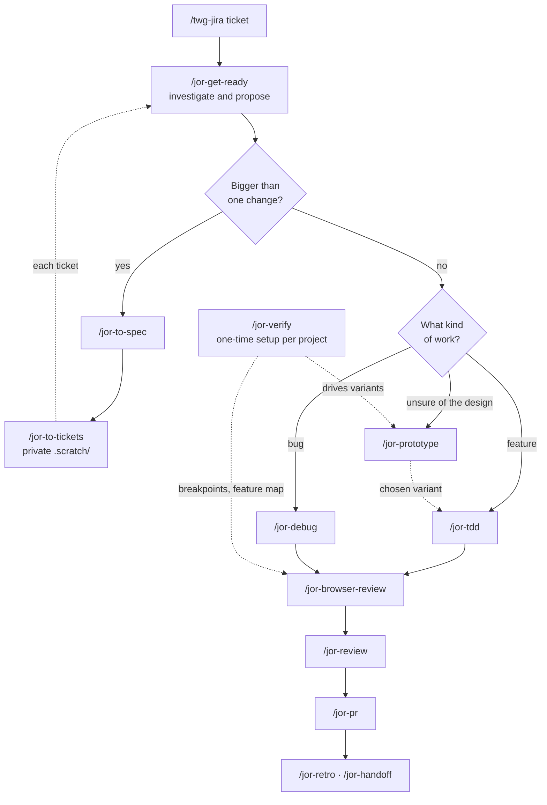

# jor-stack

18 slash-only skills plus a router, one skill per job, protected from upstream overwrites; Cursor first, Codex later.

jor-stack is Jorge Galarza's private plugin of front-end workflow skills. Every skill runs only when you type its `/jor-...` name. Nothing triggers on its own.

## At a glance

| | Count |
| --- | --- |
| Skills, including the `/jor-mode` router | 19 |
| Jorge's own | 3 |
| From Matt Pocock's skills | 11 |
| From pstack | 4 |
| Auto-triggering | 0 |

Version 0.1.0 ships for Cursor. It bundles Chrome DevTools MCP for the browser skills.

## How a ticket flows

Solid arrows are the main path. Dashed arrows are loops and supporting links.

1. **Load the ticket.** Bring the Jira ticket into the conversation with `/twg-jira`. Its description, acceptance criteria and comments set the scope.
2. **`/jor-get-ready` investigates and proposes.** It reads the ticket and project rules, inspects the code, callers, tests and patterns, and reproduces the bug or confirms the gap. When a decision is unclear it runs `/jor-grill-me`. It returns a proposal with evidence, the smallest complete change, risks and checks, then stops. It changes no files.
3. **Bigger than one change?** If yes, `/jor-to-spec` writes the spec to `.scratch/<feature-slug>/spec.md`. Then `/jor-to-tickets` splits it into tracer-bullet tickets, one file each under `.scratch/<feature-slug>/issues/`, blockers first. Take each ticket back through `/jor-get-ready`.
4. **What kind of work?** For a feature, `/jor-tdd` builds it one red-green slice at a time at seams you agree on. For a bug, `/jor-debug` builds a tight feedback loop first, then reproduces, minimises, hypothesises, instruments, and fixes with a regression test. If you're unsure of the design, `/jor-prototype` builds throwaway variants, screenshots them at the project's breakpoints for side-by-side comparison, and the chosen variant goes into `/jor-tdd`.
5. **`/jor-browser-review` checks it in a real browser.** It uses Chrome DevTools MCP, preferably through one independent subagent. It checks the breakpoints 360, 768, 1280, 1440 and 1920, interactions, overflow, console errors and failed requests. It ends with a Human verification section of exact URLs for you to open.
6. **`/jor-review` reviews the diff on two axes.** Standards covers the repo's coding standards plus a code-smell baseline. Spec checks against the ticket already in the conversation or the `/jor-to-spec` file. The two reports stay separate.
7. **`/jor-pr` writes the PR body.** It shows the smallest visual that explains the change, before and after evidence (screenshots are best), and the merge danger: one-way or two-way door, and blast radius.
8. **`/jor-retro` and `/jor-handoff` close the loop.** `/jor-retro` suggests improvements to the agent's environment (checks, standards, navigation pointers), not the code. `/jor-handoff` writes a handoff file when the work continues in a fresh session, another directory, or with a colleague.

**One-time setup per project: `/jor-verify`.** It generates the project's own `verify-<project>` skill on Chrome DevTools MCP, with `doctor` (health check), `breakpoints` (screenshots at 360, 768, 1280, 1440 and 1920) and `snapshot` (page and DOM state) commands, plus a feature map. `/jor-prototype` uses it to drive variants. `/jor-browser-review` uses its breakpoints and feature map.

## Skills

| Skill | Based on | Job | What changed |
| --- | --- | --- | --- |
| `/jor-mode` | New, layout from Matt's `ask-matt` | Router: lists every jor skill, when to use it, and the main flow | New. Points to `/jor-restate` for an understanding check |
| `/jor-get-ready` | Jorge's `get-ready` | Investigate the loaded ticket and propose, no edits | Slash-only. Uses `/jor-grill-me` for open decisions and `/jor-browser-review` for browser checks. "Confirm when ready" merged into the stop rule |
| `/jor-restate` | Jorge's `restate` | Restate your goal and problem, then stop | Name only |
| `/jor-grill-me` | Matt's `grill-me` + `grilling` | Relentless interview in rounds, writes no files | Inlined the grilling text so it stands alone |
| `/jor-browser-review` | Jorge's `browser-review` | Independent browser review with Chrome DevTools MCP | Slash-only. Model-neutral wording. Concrete breakpoints and feature map from the verify skill. Typo fix |
| `/jor-to-spec` | Matt's `to-spec` | Turn the thread into a spec | Writes `.scratch/<feature-slug>/spec.md`, adds `.scratch/` to `.git/info/exclude`. No tracker, no setup skill, no triage label |
| `/jor-to-tickets` | Matt's `to-tickets` | Split a spec into tracer-bullet tickets with blockers | Always local files under `.scratch/<feature-slug>/issues/`. No tracker branch, setup line or triage label |
| `/jor-tdd` | Matt's `tdd` (+ `tests.md`, `mocking.md`) | Red-green loop at agreed seams | Trimmed. Points to `/jor-design` and `/jor-review` |
| `/jor-debug` | Matt's `diagnosing-bugs` (+ HITL script) | Feedback-loop-first bug diagnosis | Close to upstream. Browser loops can use Chrome DevTools MCP |
| `/jor-design` | Matt's `codebase-design` (+ helpers) | Deep-module vocabulary for shaping interfaces | Close to upstream |
| `/jor-review` | Matt's `code-review` | Two-axis review: Standards and Spec | Spec comes from the ticket in the conversation or the `/jor-to-spec` file, instead of asking |
| `/jor-pr` | Matt's `pr` (+ credits) | Write the PR body | Close to upstream. Slash-only |
| `/jor-prototype` | Matt's `prototype` (+ `LOGIC.md`, `UI.md`) | Throwaway prototype for one design question | UI variants driven and screenshotted at 5 breakpoints. Capture step needs no issue tracker |
| `/jor-retro` | Matt's `retro` | Retrospective on the agent's environment | Close to upstream. Dropped the `writing-for-agents` dependency |
| `/jor-handoff` | Matt's `handoff` | Handoff document for a fresh session | Close to upstream. Suggests `/jor-...` skills |
| `/jor-domain` | pstack `principle-model-the-domain` | Encode the domain in a data structure | Close to upstream. Slash-only |
| `/jor-teach` | pstack `teach` | Explain a body of work plainly | Heavy trim. No dependency on pstack's `how`, `why` or `unslop` |
| `/jor-verify` | pstack `create-verification-skill` (+ example map) | Generate `verify-<project>` | Rebuilt on Chrome DevTools MCP. `doctor`, `breakpoints`, `snapshot`, feature map. Never starts your dev server |
| `/jor-verify-maintain` | pstack `maintain-verification-skill` | Keep the verify skill and map honest | Trimmed to Chrome DevTools. Breakpoint screenshots are the evidence. Edits only the verify skill's folder |

Exact upstream paths and commits are in [UPSTREAM.md](UPSTREAM.md).

## Outside the main flow

- **`/jor-grill-me`** when you start from an idea instead of a ticket. It interviews you until every decision is settled.
- **`/jor-restate`** when you want to check the agent understood your goal before it starts.
- **`/jor-design`** and **`/jor-domain`** while shaping code. `/jor-design` gives the vocabulary for module interfaces and seams. `/jor-domain` pushes logic into the right data structure instead of more `if` branches.
- **`/jor-mode`** when you don't remember which skill fits.
- **`/jor-teach`** when you want to really understand a change or subsystem.
- **`/jor-verify-maintain`** on demand or after UI-heavy sprints. It reports clean, changed, or blocked.

## Private working files

Specs, tickets, verification evidence and run notes go in `.scratch/` inside the project. Before writing there, the skills check `.git/info/exclude` and add `.scratch/` if it's missing. That file is git's local-only ignore list, so the files stay private to your machine. The team's shared `.gitignore` is never touched, and these files are never committed.

## Rules every skill follows

- **Slash-only.** Every skill has `disable-model-invocation: true`. Nothing runs unless you type it.
- **One skill per job.** No skill does another skill's work; skills point to each other by `/jor-...` name.
- **Self-contained.** No links to skills outside jor-stack and no setup skill to run first.
- **Tool-neutral.** No Cursor-only features and no hardcoded model names, so packaging for Codex later is easy.
- **Upstream voice kept.** Skills marked close to upstream keep the original wording. Trims cut text rather than rewrite it.
- **Traceable.** Each skill's frontmatter has a `metadata.based-on` line naming the upstream repo, path and commit, or "original by Jorge".

## How your edits stay safe from upstream

- **Copies, not links.** Every skill is a copy inside this repo. Nothing pulls from Matt's repo or pstack at runtime, so an upstream change can't overwrite your edits.
- **Recorded commits.** [UPSTREAM.md](UPSTREAM.md) lists the exact commit each skill was copied from, so you can diff upstream against that point later.
- **Edit only in this repo.** Never edit the installed copy in Cursor's plugin cache. It's replaced on every update. Change the repo, commit, and reinstall or refresh.
- **Upstream updates are a manual review.** When an upstream skill changes, compare it with the recorded commit and merge by hand only what you want.

## Install

Choose one:

- **Local folder.** Copy this folder to `~/.cursor/plugins/local/jor-stack`, then run **Developer: Reload Window**. A copied folder is safest: Cursor skips symlinks that point outside `~/.cursor/plugins/local`.
- **From your private GitHub repo.** Push this folder to your private repo, then in Cursor open **Customize → From GitHub Repository** and paste the repo URL. The repo root has `.cursor-plugin/marketplace.json`, which lists the single `jor-stack` plugin at the root.

Open **Customize** afterwards and confirm the 19 `jor-` skills and the `chrome-devtools` MCP server are listed. The MCP server runs `npx -y chrome-devtools-mcp@latest`, so Node.js and Chrome must be installed.

## After install

1. Remove the pstack plugin.
2. Remove Matt Pocock's skills.
3. Remove the old `get-ready`, `restate` and `browser-review` skills, so only the `jor-` versions remain.
4. Run `/jor-verify` once in each project to generate its `verify-<project>` skill.

## Not in v0.1 / roadmap

### Already decided out

- pstack `figure-it-out` (was `/jor-plan`). Covered by `/jor-to-spec` + `/jor-to-tickets`.
- pstack `principle-prove-it-works`. Covered by `/jor-browser-review`.
- pstack `in-your-own-words`. Covered by `/jor-restate`.
- pstack `interrogate`, `arena`, `architect`. Multi-model checks, too heavy.
- pstack `swarm`. Parallel agents.
- pstack formal verification skills and `statechart`.
- pstack `benchmark-checklist`, `recall`, `technical-writing`.
- Matt's `grilling`. Inlined in `/jor-grill-me`.
- Matt's `grill-with-docs`. It writes docs.
- Matt's `setup-matt-pocock-skills`. Not needed.
- Matt's other skills, including the auto-triggering ones.
- Addy Osmani's agent-skills.

### Skipped by default, could be added later

- pstack `blast-radius`, `how`, `why`, `unslop`, `reflect`, `sharpen`, `ketchup`, `correct`, `show-me-your-work`, `bro`, `no-comments`, `automate-me`, `setup-pstack`.
- pstack's other `principle-*` skills.

### Planned later

- **Codex support.** A Codex manifest plus `agents/openai.yaml` per skill with `allow_implicit_invocation: false`.
- **Skill doctor.** A bot that watches upstream and proposes merges without overwriting your edits.
- **Emil Kowalski's animation skills** ([emilkowalski/skills](https://github.com/emilkowalski/skills)) as `jor-` skills. They're installed separately for now.
